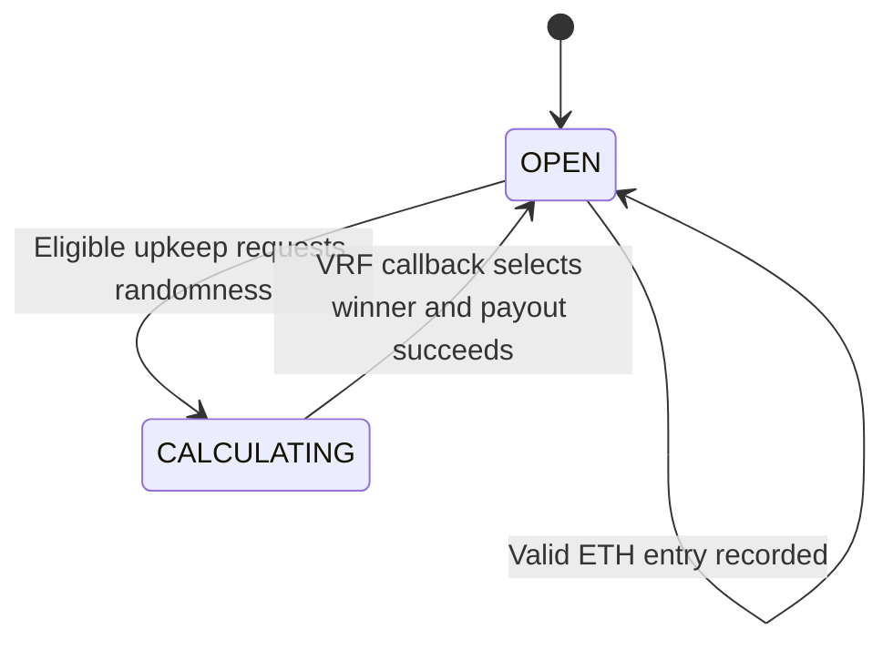

<div align="center">


# OnChainLuck

**An onchain raffle. A verifiable draw.**

An Ethereum raffle built with Solidity and Foundry,<br />using Chainlink VRF v2.5 for randomness and Automation-compatible upkeep.

[](https://soliditylang.org/)
[](https://getfoundry.sh/)
[](https://chain.link/vrf)
[](https://github.com/Shivasaiyadav08/OnChainLuck-Contract/actions/workflows/test.yml)

[Frontend](https://github.com/Shivasaiyadav08/SmartContractLotteryFrontend) · [Getting started](#getting-started) · [Raffle lifecycle](#raffle-lifecycle) · [Contract interface](#contract-interface)

</div>

---

## Overview

OnChainLuck implements a recurring ETH raffle. Each successful call to `enterRaffle()` records one entry. Once the configured interval has elapsed and the round has both entries and funds, upkeep can request a random word from Chainlink VRF.

The VRF callback selects an entry, records the winner, clears the entries, reopens the raffle, and attempts to transfer the entire contract balance to the selected address. The companion [DeRaffle frontend](https://github.com/Shivasaiyadav08/SmartContractLotteryFrontend) provides the wallet and ticket interface.

## Capabilities

- **ETH entry payments** with a constructor-configured minimum entrance fee.
- **Verifiable randomness** requested through Chainlink VRF v2.5.
- **Upkeep eligibility checks** based on elapsed time, state, player count, and contract balance.
- **Two explicit round states:** `OPEN` and `CALCULATING`.
- **Winner selection and payout** inside the coordinator-authorized fulfillment callback.
- **Foundry tooling** for unit tests, local mocks, deployment, and subscription interactions.
- **GitHub Actions CI** configured for formatting, build checks, and tests.

## Technology stack

| Technology | Role |
| --- | --- |
| Solidity `^0.8.20` | Raffle contract and scripts |
| Foundry | Forge builds and tests, Anvil local node, Cast interaction |
| Chainlink VRF v2.5 | Coordinator-backed random word fulfillment |
| Chainlink Automation interface | `checkUpkeep` and `performUpkeep` entry points |
| Forge Standard Library | Testing utilities and script support |
| Foundry DevOps | Deployment lookup in interaction scripts |
| Solmate | Dependency used by the local mock token |
| GitHub Actions | Automated format, build, and test workflow |

## Raffle lifecycle



1. **Enter.** A caller sends at least the entrance fee. The contract appends the caller to `s_players` and emits `RaffleEntered`.
2. **Check eligibility.** `checkUpkeep()` requires the round to be open, elapsed time to be strictly greater than the interval, at least one entry, and a positive balance.
3. **Request randomness.** `performUpkeep()` validates those conditions, changes the state to `CALCULATING`, and requests one random word.
4. **Settle.** The callback chooses `randomWords[0] % s_players.length`, resets the round, and transfers the full balance. A failed transfer reverts the callback.

Each successful entry call creates one slot. Sending more ETH in a single call increases the contribution but does not create additional slots. An address can enter more than once while the round is open.

The configured interval is a minimum eligibility threshold, not a guaranteed draw schedule. Upkeep execution, block inclusion, and VRF fulfillment determine when a round actually settles.

## Getting started

### Prerequisites

- Git with submodule support.
- [Foundry](https://getfoundry.sh/) installed, with `forge`, `cast`, and `anvil` available.
- A Bash-compatible shell for the commands below; Windows developers can use WSL.

### Clone and build

```bash
git clone --recurse-submodules https://github.com/Shivasaiyadav08/OnChainLuck-Contract.git
cd OnChainLuck-Contract
forge build
```

For an existing clone with missing dependencies:

```bash
git submodule update --init --recursive
```

Dependencies are tracked as Git submodules. `foundry.toml` maps the Chainlink and Solmate imports to their paths in `lib/`.

### Run tests

```bash
forge test -vvv
```

The unit suite in `test/unit/Raffletest.t.sol` exercises entry validation, entry events, initial state, closed-entry behavior during a draw, upkeep conditions, invalid fulfillment requests, and winner payout with round reset.

These are the tests present in the repository; this README does not assert a coverage percentage or a successful run in your environment.

### Format and validate before pushing

```bash
forge fmt
forge fmt --check
forge build --sizes
forge test --gas-report
forge snapshot
```

`forge fmt` updates Solidity formatting; `forge fmt --check` only checks it. Review and commit the formatted Solidity files before pushing. Editing this README does not resolve a Solidity formatting failure.

The GitHub Actions workflow runs formatting, build-size checks, and verbose tests. Its badge above reflects the live workflow state.

## Configuration

Network settings live in `script/Helperconfig.s.sol`.

| Parameter | Checked-in Sepolia configuration |
| --- | --- |
| Chain ID | `11155111` |
| Entrance fee | `0.01 ether` |
| Interval | `30` seconds |
| Callback gas limit | `500000` |
| Random words | `1`, defined in the raffle contract |
| Request confirmations | `3`, defined in the raffle contract |
| VRF payment | LINK (`nativePayment: false`) |

The helper also contains local Anvil and Ethereum mainnet configurations. The presence of a mainnet configuration is not a production-readiness claim.

Before a public-network deployment, review the configured account, subscription ID, coordinator address, LINK address, and gas lane. These values are checked into the helper rather than loaded dynamically from environment variables. Confirm network-specific service details against [Chainlink documentation](https://docs.chain.link/) before deploying.

## Deployment

`script/DeployRaffle.s.sol:DeployRaffle` reads the network configuration, creates and funds a subscription when the configured ID is zero, deploys `Raffle`, and adds it as a VRF consumer. When using an existing subscription, ensure it is funded and owned by the account used for consumer registration.

### Sepolia preparation

1. Set the Sepolia `account` in `script/Helperconfig.s.sol` to the deployer you control.
2. Set a subscription ID owned by that account, or use `0` to follow the script's subscription-creation path.
3. Provide test ETH for transactions and test LINK for the VRF subscription.
4. Configure `SEPOLIA_RPC_URL` in your shell.

An encrypted Foundry keystore can provide the deployment signer:

```bash
cast wallet import sepolia-deployer --interactive
```

### Simulate, then broadcast

Run a simulation first:

```bash
forge script script/DeployRaffle.s.sol:DeployRaffle \
  --rpc-url "$SEPOLIA_RPC_URL" \
  --account sepolia-deployer
```

After reviewing the simulation, broadcast with:

```bash
forge script script/DeployRaffle.s.sol:DeployRaffle \
  --rpc-url "$SEPOLIA_RPC_URL" \
  --account sepolia-deployer \
  --broadcast
```

The keystore account must match the account configured in the helper. Keep private keys and keystore passwords outside the repository.

Deployment does not register or fund an Automation upkeep. To run draws through Chainlink Automation, configure that service separately against the deployed raffle. A funded VRF subscription alone does not schedule `performUpkeep()` calls.

### Script naming

Use the exact filename casing on Linux and in CI:

```text
script/Helperconfig.s.sol
script/interactions.s.sol
script/DeployRaffle.s.sol
```

Some Makefile interaction targets reference `Interactions.s.sol` with a capital `I`, while the checked-in file is lowercase. If invoking those scripts directly, use `script/interactions.s.sol:CreateSubscription`, `:FundSubscription`, or `:AddConsumer` as appropriate.

## Contract interface

| Method | Purpose |
| --- | --- |
| `enterRaffle()` | Payable entry; requires sufficient ETH and an open round |
| `checkUpkeep(bytes)` | Read whether a draw is eligible |
| `performUpkeep(bytes)` | Validate eligibility and request randomness |
| `getEntraceFee()` | Read the entrance fee; spelling matches the contract ABI |
| `getPlayer(uint256)` | Read an entry address by index |
| `getNumberOfPlayers()` | Read the number of entry slots in the current round |
| `getRaffleState()` | Read `OPEN` (`0`) or `CALCULATING` (`1`) |
| `getRecentWinner()` | Read the most recently selected winner |
| `getLastTimeStamp()` | Read the round timestamp |
| `getInterval()` | Read the eligibility interval |
| `getAmountOfAddress(address)` | Read cumulative contributions from an address |

The contribution mapping is not cleared during round reset, so `getAmountOfAddress()` is not a per-round balance.

### Events

| Event | Emitted when |
| --- | --- |
| `RaffleEntered(address indexed player)` | An entry is accepted |
| `RequestedRaffleWinner(uint256 indexed requestId)` | VRF randomness is requested |

### Custom errors

- `Raffle__SendMoreToEnterRaffle`
- `Raffle__RaffleNotOpen`
- `Raffle__UpkeepNotNeeded`
- `Raffle__TransferFailed`

## Project structure

```text
src/
└── Raffle.sol                 # Entry, upkeep, randomness, and payout
script/
├── DeployRaffle.s.sol         # Deployment and consumer registration
├── Helperconfig.s.sol        # Network configuration and local mocks
└── interactions.s.sol        # Subscription creation, funding, and consumers
test/
├── mocks/LinkToken.sol        # Local LINK token mock
└── unit/Raffletest.t.sol      # Raffle unit tests
lib/                          # Git submodule dependencies
broadcast/                    # Deployment transaction artifacts
.github/workflows/test.yml    # Foundry CI workflow
foundry.toml                  # Build paths and import remappings
makefile                      # Development shortcuts
```

## Frontend integration

The [DeRaffle frontend](https://github.com/Shivasaiyadav08/SmartContractLotteryFrontend) uses Next.js, RainbowKit, Wagmi, and Viem. To connect a new deployment, update its contract address and ABI in `src/constants.ts` and keep the enabled network consistent with the deployment chain.

Preserve the existing getter spelling `getEntraceFee()` when generating or consuming the ABI.

## Development considerations

This project is intended for development and testnet use. The repository does not provide an independent security audit. In particular, payout occurs inside the VRF callback: a recipient that rejects ETH can cause settlement to revert. Review callback failure handling and operational recovery before considering other uses.

## Licensing

`src/Raffle.sol` declares `SPDX-License-Identifier: UNLICENSED`. No repository-level license file is present in the reviewed source tree. Do not assume an MIT or other open-source license from the project's public visibility.

## Author

Built by [Shiva Sai Yadav](https://github.com/Shivasaiyadav08).

---

<div align="center">
<sub>Solidity · Foundry · Chainlink VRF v2.5 · Ethereum</sub>
</div>
